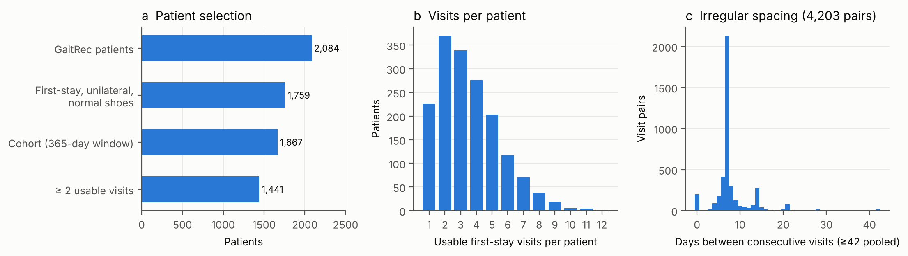
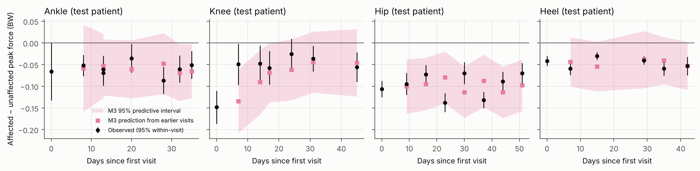
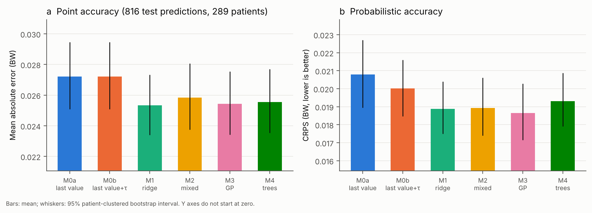
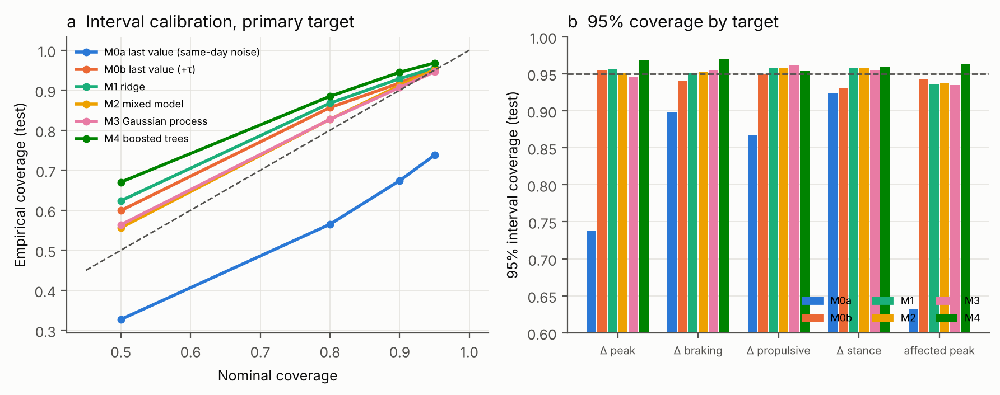
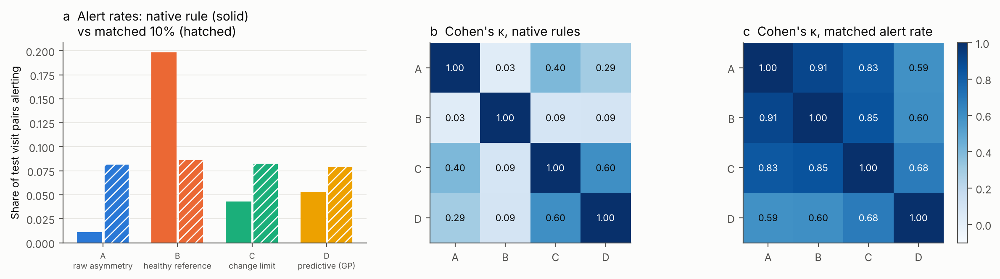
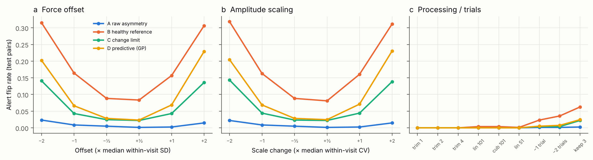
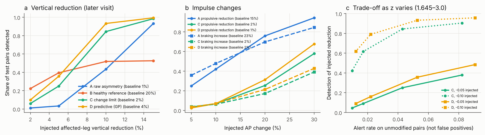
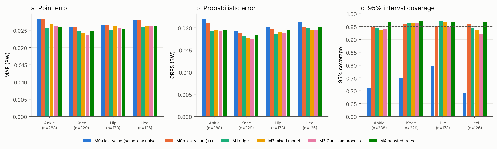

# Abstract

**Background.** Force-plate gait measurements are repeated during lower-limb rehabilitation, but a change between two visits is hard to read: trial noise, day-to-day variation and genuine change overlap. We asked whether longitudinal probabilistic models predict a patient's next measurement more reliably than simple rules, whether their uncertainty is calibrated, and whether common monitoring rules agree when applied to the same visits.

**Methods.** GaitRec ground reaction forces from an Austrian workers' compensation rehabilitation centre: 1,667 patients (knee, ankle, hip, heel injuries), 5,870 visits, 4,203 consecutive visit pairs. Patients were split 60/20/20 (training, calibration, test) under a frozen, hashed protocol. Each visit was predicted from earlier visits only, by last value carried forward with same-day noise (M0a) or with between-visit variation (M0b), ridge regression (M1), a linear mixed model (M2), a Gaussian process (GP, M3) and gradient-boosted trees (M4). Primary target: affected-minus-unaffected peak vertical force. Four monitoring architectures (raw asymmetry, healthy reference, statistical change limit, GP prediction deviation) were compared on identical pairs, under controlled perturbations and injected changes. Patient-clustered bootstraps were used throughout.

**Results.** In 816 test predictions (289 patients), intervals built on same-day noise covered 73.8% of measured values against a nominal 95%; the GP covered 94.6% (H2 met). The GP's CRPS was lower than the pre-chosen comparator (mixed model) by 0.00028 BW (95% CI 0.00008 to 0.00049; about 1.5%; H1 formally met), but not lower than ridge regression, not in a temporal hold-out, and not for any secondary target. All history-based models reduced point error by about 6% compared with the last value (GP −0.0018 BW, 95% CI −0.0026 to −0.0009). The GP's intervals were 14% narrower than the corrected last-value intervals at similar coverage. Monitoring rules disagreed sharply under their own thresholds (Cohen's κ 0.03 to 0.60) and moderately even at a matched alert rate (κ 0.59 to 0.91), with the GP-deviation rule the outlier. In injected-change experiments the GP-deviation rule detected more mathematical reductions than the change limit at every matched baseline alert rate (36% vs 25% for a 5% vertical-force reduction at z = 1.96), but it also flipped more often under force perturbations. Asymmetry-based rules missed bilateral reductions entirely.

**Conclusions.** The value of the longitudinal models here is calibrated, patient-specific uncertainty, not markedly better point forecasts; a well-tuned linear model is nearly as good. Monitoring conclusions depend strongly on the rule chosen. None of these results concern clinical recovery: the dataset has no functional outcomes.

# 1. Introduction

When rehabilitation teams, case managers or workers' compensation adjusters see quantitative movement data, a number on its own does not say whether a patient has changed. A visit-to-visit change mixes trial-to-trial noise, day-to-day variation in the person and the measurement setting, and genuine change in function. The earlier GaitSense report showed this concretely in GaitRec: same-day trial noise understated visit-to-visit variation by about half, so 28% of changes crossed a nominal 5% limit; adding a between-visit variance component (τ) fixed the calibration but made small declines harder to see.

Two questions follow. First, can a model that uses each patient's whole history predict the next measurement, and say how uncertain that prediction is, better than a rule based on the last visit? Gaussian processes and mixed models are natural candidates because they handle irregular visit timing and give full predictive distributions (Rasmussen and Williams 2006; Laird and Ware 1982). Patient-specific GP trajectories have been used for chronic disease and dementia forecasting (Futoma et al. 2016; Peterson et al., arXiv 2017; Liang et al., arXiv 2020); in a focused search we did not find them applied to forecasting repeated ground reaction force measurements in rehabilitation. Most machine-learning work on GaitRec and similar force datasets classifies gait disorders from a session (Horsak et al. 2020; Slijepcevic et al. 2022; Pandey et al. 2022). The closest longitudinal work is Chakraborty et al. (2022), who trained an LSTM autoencoder on healthy GaitRec gait and used its reconstruction error across patients' rehabilitation sessions as an indicator of recovery status; that approach scores distance from healthy gait rather than forecasting the next measurement with calibrated uncertainty. Second, do common monitoring rules agree? Clinical biomechanics uses limb symmetry indices, comparison with healthy norms, and minimal-detectable-change limits (Weir 2005); these answer different questions, and in our search we did not find studies quantifying how often they disagree on the same visits.

We evaluate predictions with proper scoring rules (Gneiting and Raftery 2007), report calibration alongside accuracy, and state negative results. Details of what is and is not new are in `docs/novelty_assessment.md`.

# 2. Methods

## 2.1 Data, cohort and partition

GaitRec (Horsak et al. 2020) contains bilateral ground reaction forces recorded at a rehabilitation centre of the Austrian Workers' Compensation Board (AUVA), 2007 to 2018. We verified from the RAW files that forces are in newtons at 250 Hz, cut to stance at a 25 N vertical threshold, with no interior missing samples (151,464 trials). The cohort is the 1,667 patients of the earlier frozen protocol (first first-stay session unilateral, normal shoes, full 365-day window). A visit is a first-stay normal-shoe session in which both legs have at least three valid trials. All patient sessions were recorded at self-selected speed; healthy controls (211) walked at three speeds, so the healthy reference uses self-selected-speed sessions only.

Patients were split by patient, stratified by injury class, into training (1,001), calibration (333) and test (333) sets (seed 20261024). Healthy controls were split the same way. A secondary temporal set (92 patients outside the 365-day window; 271 predictions) had been opened once before for a different study and is reported separately. The protocol (`docs/ai_protocol.md`) was hashed before any model was fitted; deviations are listed in `docs/ai_deviations.md`.

## 2.2 Features

Per trial: peak vertical force over stance / body weight (BW), braking and propulsive impulse (BW·s), stance duration (s); secondary curve features (first and second peak, valley, loading rate, vertical impulse), set to missing when a curve has no distinct peaks (0.11% of trials) rather than forced. Visit summaries: per-leg means and the affected-minus-unaffected difference Y with SE from trial-to-trial variation. Re-extraction reproduced the earlier features exactly.

## 2.3 Prediction models

Each visit k ≥ 2 was predicted from visits 1 to k−1 of the same patient. M0a: last value with variance SE²_last + mean history SE². M0b: as M0a plus τ², estimated by method of moments on training pairs. M1: ridge regression on history features (last value, history mean, SD, slope, number of visits, days since last and first visit, injury class, age, sex, body mass); Gaussian SD from calibration residuals within prior-visit groups. M4: gradient-boosted trees on the same features. M2 and M3 are one model family: y = x′β + f_i(t) + ε, with fixed effects for injury class, age, sex, body mass and time, a patient-level process f_i, and noise variance σ²_w + SE²_ij (known within-visit variance plus an extra term). M2 uses a random intercept and slope (chosen over intercept-only by training AIC); M3 uses a stationary GP kernel (Matérn or RBF, plus constant, optionally plus linear) chosen by calibration-set log predictive density. Hyperparameters were fitted by maximum marginal likelihood pooled over training patients. Our implementation matched scikit-learn's GaussianProcessRegressor to machine precision.

## 2.4 Evaluation and hypotheses

Metrics: MAE, RMSE, coverage of 50/80/90/95% intervals, interval width, interval score, CRPS and log predictive density, by injury class, number of prior visits and gap. Uncertainty: 2,000 patient-level bootstrap resamples. **H1** (confirmatory): GP CRPS lower than the best of M0b, M1 and M2, chosen on calibration patients before the test set was opened. **H2** (confirmatory): GP 95% coverage within 0.93 to 0.97 and closer to 0.95 than M0a. H3 to H5 and E1 (informativeness of predicted SD) were exploratory.

## 2.5 Monitoring architectures

On the same test pairs (t−1, t) and the same target Y: **A**, change in limb symmetry index ≥ 10 points; **B**, crossing the healthy controls' 95% band for the signed limb difference (reference fitted on 124 training-control sessions); **C**, |ΔY| / sqrt(SE²_t + SE²_t−1 + τ²) > 1.96; **D**, the GP's standardised deviation of Y_t from its prediction from earlier visits > 1.96. We compared native rules and, separately, rules matched to a 10% alert rate on calibration pairs, using agreement, Cohen's κ, positive agreement and directional conflict. τ mixes measurement variation with genuine change and is not sensor error.

## 2.6 Perturbations and injected changes

On test pairs, the later visit's affected-leg raw trials were transformed: force offsets and amplitude scaling of ±0.5, 1 and 2 times the median within-visit SD (0.021 BW) or CV (1.9%), stance trimming by 1 to 4 samples, time-normalised feature computation, removal of trials, and removal of the previous visit. Outcome: alert flip rate. Injected changes: vertical force ±2 to 15%, propulsive impulse −5 to −30%, braking impulse +5 to +30%, a first-peak-local reduction, and a bilateral reduction. These are mathematical changes; the resulting detection rates are not clinical sensitivity, and alerts on unmodified pairs are not false positives because unmodified patients are not known to be stable.

# 3. Results

## 3.1 Future-visit prediction

| Model (test, Δ peak force) | MAE (BW) | CRPS (BW) | 95% coverage | Mean 95% width |
|---|---|---|---|---|
| M0a last value, same-day noise | 0.0272 | 0.0208 | 73.8% | 0.077 |
| M0b last value + τ | 0.0272 | 0.0200 | 95.5% | 0.151 |
| M1 ridge | 0.0253 | 0.0189 | 95.6% | 0.148 |
| M2 mixed model (random slope) | 0.0258 | 0.0189 | 95.1% | 0.133 |
| M3 GP (Matérn-3/2 + linear) | 0.0254 | 0.0187 | 94.6% | 0.131 |
| M4 boosted trees | 0.0255 | 0.0193 | 96.8% | 0.161 |

816 predictions, 289 patients. GP minus mixed model, CRPS: −0.00028 (95% CI −0.00049 to −0.00008); GP minus ridge: −0.00022 (−0.00057 to 0.00013). GP minus last value, MAE: −0.0018 (−0.0026 to −0.0009).

**H1 was formally met** for the primary target, but the effect is small (1.5% of CRPS), the GP was not better than ridge regression, the result did not replicate in the temporal set (−0.00010, CI −0.00056 to 0.00056), and H1 was not met for any secondary target (braking, propulsive, stance, affected-leg peak). **Point accuracy:** every history-based model beat the last value by 5 to 7%, unlike the smaller earlier comparison (shear report §4b), which used a different feature and test set.

**H2 was met.** Same-day-noise intervals covered 73.8% (95% CI 70.3 to 77.2%); the GP covered 94.6% (92.8 to 96.3%); the difference in absolute coverage error was −0.208 (−0.238 to −0.171). The corrected last-value rule also reached 95.5%, so the gain over M0b is sharpness: GP intervals were 14% narrower at similar coverage. Coverage held in each injury group (GP 92 to 97%) and in the temporal set (94.5%). All models except M0a over-covered at the 50% level (GP 56%), which indicates heavier-tailed errors than a Gaussian assumes: the 95% statements are reliable, narrower intervals less so.

**E1.** The GP's predicted SD was only weakly related to its actual error (Spearman 0.17; M0b 0.19). Mean absolute error rose from 0.018 BW in the lowest SD quintile to 0.035 BW in the highest, with coverage 92 to 97% in every quintile. The predicted SD is therefore calibrated on average and partly informative about which predictions to distrust, not a sharp per-patient warning. The GP's mean predictive variance split into trajectory uncertainty given the history (0.00059 BW²), extra visit-level variation σ²_w (0.00032) and within-visit measurement variance (0.00023). σ²_w is not identifiable as measurement error.

## 3.2 Monitoring disagreement

| Architecture | Native alert rate (test) | κ with C (native) | κ with C (matched 10%) |
|---|---|---|---|
| A raw asymmetry (ΔLSI ≥ 10) | 1.1% | 0.40 | 0.83 |
| B healthy reference (band crossing) | 19.9% | 0.09 | 0.85 |
| C change limit (with τ) | 4.3% | — | — |
| D GP prediction deviation | 5.3% | 0.60 | 0.68 |
| Original limit, same-day noise only | 26.3% | | |

Under their native rules the architectures flagged between 1% and 20% of the same 816 pairs, and agreement was poor except C with D (κ 0.60, 95% CI 0.46 to 0.71). At a matched alert rate, A, B and C largely agreed (κ 0.83 to 0.91) because all three score the size of the step since the last visit; D agreed least (κ 0.59 to 0.68) because it scores departure from the whole trajectory. H3's criterion for material disagreement (any matched κ < 0.60) was met narrowly (A with D, 0.59, CI 0.50 to 0.67). No pair of architectures disagreed on direction when both flagged. Between 48% and 95% of matched disagreements involved a score within 10% of its threshold. In 8 of 9 raw-asymmetry alerts, the unaffected leg changed by at least half the difference change.

## 3.3 Robustness to perturbations

Offsets and scaling changes produced nearly identical flip rates for the same multiple of within-visit variation. At ±1 within-visit SD, alerts flipped in 0.2 to 0.9% of pairs for A, 16% for B, 4.3 to 4.4% for C and 6.6 to 7.1% for D; at ±2 SD, 14% for C and 20 to 23% for D. Stance trimming of up to 16 ms and alternative time normalisation changed almost nothing (≤ 0.4%). Keeping only three trials flipped alerts in 0.2% (A) to 6.2% (B) of pairs (C 2.2%, D 2.5%). Removing the previous visit changed C's alert in 8.7% of the 527 eligible pairs (C now compares with t−2) but D's in only 3.6%; D's predictive SD widened from 0.033 to 0.038 BW and its coverage went from 95.8% to 94.5%.

## 3.4 Injected changes: the detection-stability trade-off

A 5% reduction of affected-leg vertical force at the later visit was detected (in the reduction direction) in 25% of pairs by C and 36% by D; a 10% reduction in 84% and 93%. Baseline alert rates in the same direction were 2.5% and 3.8%. Across thresholds from z = 1.645 to 3.0, D gave higher detection than C at every comparable baseline alert rate. Raw asymmetry detected almost nothing at 5% (3%) and 44% at 10%; the healthy-band rule rose only from 22% to 53% between a 2% and a 15% reduction, against a 20% baseline, because its alerts depend on where the patient sits relative to the band. Bilateral reductions were invisible to all asymmetry-based rules (C 1.7%, D 2.6% for a 10% bilateral reduction) but detected by C and D applied to the affected leg's absolute peak force (95%, 97%). Impulse changes were harder to detect: a 20% propulsive reduction was detected in 25% (C) and 31% (D). A symmetry-index rule on impulses appeared sensitive (76%) only because it alerted on 33% of unmodified pairs. Because the primary feature is the stance maximum, a reduction of the first peak alone was partly hidden when the second peak was higher (D 43% for a 15% first-peak reduction).

## 3.5 Injury groups (H5)

Point and probabilistic errors were similar across groups (GP MAE 0.024 knee to 0.026 ankle and heel), and GP coverage ranged from 92% (heel, 126 predictions) to 97% (knee). Native alert rates of C and D ranged 3 to 7% across groups. No group stood out once uncertainty was considered.

## 3.6 Post-hoc: how much of τ is present on the same day? (E2, not in the protocol)

199 consecutive pairs were two sessions on the same day. Their τ for Δ peak force was 0.015 BW (95% CI 0.010 to 0.019), against 0.031 for gaps of 1 to 7 days, 0.035 for 8 to 14 days and 0.046 beyond 14 days; within-visit SE was about 0.014 throughout. Same-day τ² is about 22% of the weekly value, and τ grows with the gap, which suggests that most between-visit variation at weekly intervals is not same-session measurement variation. Same-day sessions may share the laboratory set-up and were recorded for unknown reasons, so this is suggestive, not a test-retest estimate.

# 4. Discussion

**What the models add.** The clearest benefit is uncertainty that is right on average: same-day-noise limits mislabel one visit in four as outside expectation, while every model that represents between-visit variation is calibrated. Among those, the GP and mixed model give 12 to 14% narrower intervals than a fixed τ, because they borrow strength from each patient's own history. Point forecasts improve only modestly, and a regularised linear model is as good as the GP; the formal H1 success is too small, and too fragile across targets and the temporal set, to justify the GP over simpler models on accuracy grounds.

**Uncertainty is calibrated but only weakly individual.** Calibration holds across injury groups and SD quintiles, but the GP's SD only loosely identifies which predictions will be wrong. The prototype therefore shows predictive ranges together with their measured coverage and labels high-noise visits separately rather than presenting SD as a reliability score.

**Monitoring rules ask different questions.** Step-size rules (A, B at matched rate, C) largely agree; the trajectory rule (D) flags different visits and detects more injected reductions at the same baseline rate, at the price of more alert flips under force perturbations. The native thresholds in common use produce alert rates from 1% to 20% on identical data. Asymmetry targets cannot see bilateral change, and in 8 of 9 symmetry-index alerts the unaffected leg changed by at least half as much as the difference. Any deployed tracker has to state which question it answers.

**What is new.** Relative to Chakraborty et al. (2022), who tracked distance from healthy gait across GaitRec rehabilitation sessions, and to our knowledge otherwise, a head-to-head evaluation of probabilistic longitudinal forecasters with proper scoring rules on repeated ground reaction forces, a quantification of monitoring-rule disagreement on identical rehabilitation visits, and the same-day decomposition of τ. The methods themselves (GP regression, mixed models, bootstrap, variance-corrected limits) are standard.

**What the data cannot answer.** GaitRec has no pain, function, return-to-work or MMI outcomes, no treatment information and no reasons for readmission. Predicting a force-plate value is not predicting recovery; an alert is a measurement statement, not deterioration. Calibration is statistical, not clinical safety.

## 4.1 Limitations

Single-centre historical data from one workers' compensation rehabilitation centre (2007 to 2018); no functional outcomes; irregular visit timing with few long gaps (> 28 days: 10 test predictions); unknown reasons for return visits; limited generalisability to other injuries, devices or health systems; possible changes in measurement conditions over a decade; inability to separate measurement noise from genuine change; no prospective or external validation (the temporal set is the same centre and was opened once before); the cohort was analysed in earlier studies by the same author; Gaussian predictive distributions under heavier-tailed errors.

## 4.2 Future clinical research

A prospective study in injured workers would need: (1) same-day and between-day repeated measurements with re-setup, to separate measurement error from change; (2) independently measured outcomes at each visit, such as a validated lower-limb function scale, pain, timed walking tests, clinician-rated change and return-to-work dates; (3) pre-registered clinical definitions of meaningful improvement and decline; (4) external sites; and (5) evaluation of whether showing calibrated ranges changes clinician or case-manager decisions, with safety monitoring. Only then could any of these outputs inform treatment, case management or claims decisions.

# 5. Software and reproducibility

**AI assistance.** Code, analyses and text for this version were produced with an AI assistant (Claude, Anthropic) under the author's direction and review. Verification relied on automated tests, a clean-room re-implementation and full re-runs; no independent person has reviewed the work.

Python package `src/gaitsense_ai/` (ingestion, quality control, features, cohort, splits, longitudinal models, prediction, evaluation, monitoring, perturbation); scripts `scripts/ai/s3a` to `s9b`; 25 new tests (124 total); clean-room verification (`verification/independent_ai.py`, 35 checks); run manifest with checksums. Re-running the full pipeline reproduces every result file byte for byte. Research prototype: `prototype/gaitsense_ai_review.html`.

# References

1. Angelopoulos AN, Bates S. A gentle introduction to conformal prediction and distribution-free uncertainty quantification. arXiv:2107.07511; 2021–2022.
2. Chakraborty J, Upadhyay S, Nandy A. Musculoskeletal injury recovery assessment using gait analysis with ground reaction force sensor. *Medical Engineering & Physics*. 2022;103:103788.
3. Chou T-Y, Reeves K, Melton D, Doherty D, Zandiyeh P. Kinetic asymmetry in unilateral transfemoral amputees: gait biomechanics and reliability assessments. 2026. doi:10.1097/PXR.0000000000000572.
4. Collins GS, Moons KGM, Dhiman P, et al. TRIPOD+AI statement. *BMJ*. 2024;385:e078378.
5. Futoma J, Sendak M, Cameron B, Heller K. Predicting disease progression with a model for multivariate longitudinal clinical data. *Proceedings of the 1st Machine Learning for Healthcare Conference*, PMLR 56:42–54; 2016.
6. Gneiting T, Raftery AE. Strictly proper scoring rules, prediction, and estimation. *Journal of the American Statistical Association*. 2007;102(477):359–378.
7. Horsak B, Slijepcevic D, Raberger AM, Schwab C, Worisch M, Zeppelzauer M. GaitRec, a large-scale ground reaction force dataset of healthy and impaired gait. *Scientific Data*. 2020;7:143.
8. Laird NM, Ware JH. Random-effects models for longitudinal data. *Biometrics*. 1982;38(4):963–974.
9. Liang J, Wu Y, Xu D, Honavar V. Longitudinal deep kernel Gaussian process regression. arXiv:2005.11770 (AAAI 2021).
10. Pandey C, Roy DS, Poonia RC, et al. GaitRec-Net: a deep neural network for gait disorder detection using ground reaction force. *PPAR Research*. 2022. doi:10.1155/2022/9355015.
11. Peterson K, Rudovic O, Guerrero R, Picard RW. Personalized Gaussian processes for future prediction of Alzheimer's disease progression. arXiv:1712.00181; 2017.
12. Rasmussen CE, Williams CKI. *Gaussian Processes for Machine Learning*. MIT Press; 2006.
13. Slijepcevic D, Horst F, Lapuschkin S, et al. Explaining machine learning models for clinical gait analysis. *ACM Transactions on Computing for Healthcare*. 2022. doi:10.1145/3474121.
14. Weir JP. Quantifying test-retest reliability using the intraclass correlation coefficient and the SEM. *Journal of Strength and Conditioning Research*. 2005;19(1):231–240.
