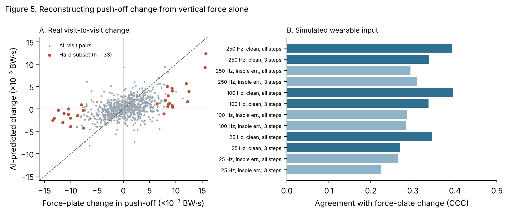
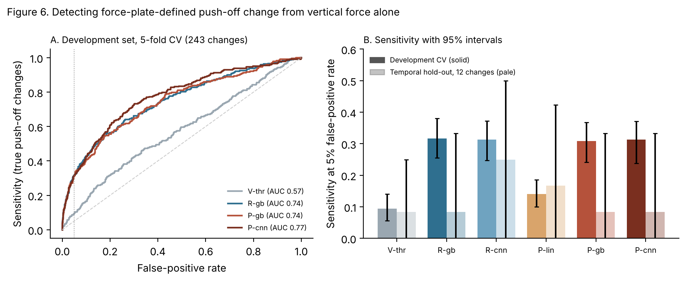

# Summary

Low-cost pressure insoles measure vertical foot force only. Braking and push-off, which change during recovery from lower-limb injury, need laboratory force plates. This study used GaitRec, a dataset from a rehabilitation centre of the Austrian Workers' Compensation Board, to ask two questions:

- Can AI reconstruct braking and push-off from vertical force well enough to follow *real* visit-to-visit change?
- Where do current measurement approaches fail?

Each failure was then written down as a requirement, a "design input", for a future tracker.

**Main results.** These are for held-out patients aged 18–65: 320 patients and 783 visit pairs.

- **The usual vertical summary carries no push-off information.** Change in peak vertical loading agreed with the force-plate change in push-off at a concordance correlation (CCC) of 0.001.
- **The full vertical curve does carry it.** Across training patients, change in the whole curve explained 32% of the variance in push-off change and 36% in braking change. Peak loading alone explained 0% for push-off.
- **The AI tracked real changes moderately and got their direction right, but captured only part of their size.** The AI was a gradient-boosting model.
  - CCC with the measured push-off change was 0.39. It was 0.33 for a linear model, and 0 for the "no change" baseline and for the vertical-only summary.
  - When push-off truly changed beyond its limit, the AI had the direction right 89% of the time.
  - In the hard cases, where push-off changed but peak vertical loading did not, it had the direction right 88% of the time (95% CI 77–97%). The vertical-only summary managed 58%.
  - Its predicted changes were *calibrated*: on average, the true change equalled the predicted change (calibration slope 0.99, Section 5). But they explained only about a quarter of the variation in true change, so their spread is much narrower than the truth. It flagged only 30% of real beyond-limit changes, with 96% specificity.
- **All four pre-stated success criteria were met.** The criteria concern agreement and direction. They do not mean the AI can stand in for a force plate.
- **Simulated wearable conditions reduced agreement gradually.**
  - Sampling at 100 Hz lost nothing.
  - Sampling at 25 Hz lowered CCC from 0.39 to 0.35.
  - Insole-scale gain and noise error lowered it to 0.29.
  - Using three steps per leg lowered it to 0.34.
  - Crossing rates stayed between 3.6% and 7.2% throughout.
- **The planted-decline analysis was uninformative, as the critique predicted.** It changed the vertical curve artificially, and the AI did not respond to that change.
- **Final experiment (Section 5): training on change itself does not help.** Models that saw both visits and were trained directly on change were tested under a separate frozen protocol. They detected real push-off changes no better than the reconstruction approach: 31% vs 32% at a 5% false-positive rate, difference −8 to +6 points. On a temporal hold-out of 81 later patients, sensitivity was 8% (95% CI 0–33%, 12 changes). Across the evaluated models, vertical-force measurements provided insufficient information to reliably detect most force-plate-defined push-off changes, and more sophisticated modelling did not resolve this.
- **Two further failure modes, using force-plate data only:**
  - When the injured-minus-uninjured difference crossed its limit, the uninjured leg had itself changed beyond its own limit in 49% of cases.
  - A forecast built on each patient's history did not beat simply carrying forward the last visit's value.

**What this does not show.**

- It does not show real insoles work. The inputs were force-plate vertical signals.
- It does not show a clinical benefit. Nothing was compared against pain, function, return to work or maximum medical improvement (MMI).
- It does not show the AI can replace a force plate. The AI explains only about a quarter of the variation in real change.

# 1. Methods

The protocol was written and hashed before any per-step data were loaded. It was amended once, after an outside critique, and that amendment also came before any data were loaded. Both hashes are recorded in `docs/shear_protocol.sha256`.

**Data.** Source data:

- The four raw GaitRec force files were re-downloaded and matched figshare's MD5 checksums.
- Each step's vertical force was divided by body weight and resampled to 101 points across stance.
- Braking and push-off impulses were computed as in the earlier report, and matched it to 10⁻¹⁶.

The analysed sample:

- **Patient data:** 97,598 valid steps from 1,667 patients (5,870 first-stay visits).
- **Healthy controls:** 5,278 steps, from self-selected-speed sessions.

**Split.** Patients were split 60/20/20 into training, validation and test sets (seed 0). All tuning and the choice of "the AI" used validation patients only.

**Models.** Each model predicts one step's braking and push-off impulses from:

- the vertical curve;
- stance time;
- body mass;
- injury group;
- leg (affected or unaffected).

The models compared:

- **M-lin:** ridge regression on 13 hand-crafted curve features.
- **M-gb:** gradient boosting on those features plus the curve.
- **M-mlp:** a neural network on the curve. It replaces the planned 1D CNN because no deep-learning library was available.
- **M-cnn (post hoc):** a true 1D convolutional network, added after the main analysis. It was written in NumPy (`src/gaitrec_rehab/cnn1d.py`), with gradients checked numerically by a unit test, because PyTorch could not be installed. Its layers are two convolutions, mean pooling within six time segments of stance and a dense head. A PyTorch version of the same network is in `scripts/shear_cnn_pytorch.py`, but it has not been run.
- **M-persist:** always predicts no change.
- **Vertical only:** change in peak loading, linearly calibrated to push-off.

M-gb was chosen as "the AI" on validation patients. Its CCC was 0.41, against 0.37 for M-mlp.

**Visit-level tracking.** This step is unchanged from the earlier report:

- Signal: affected-minus-unaffected visit means, with standard errors from repeated steps.
- Limit: 1.96 × √(SE₁² + SE₂² + τ²).
- τ is estimated on validation patients, separately for each signal.

# 2. Results

## 2.1 Per-step accuracy (Study 1, test patients aged 18–65)

| Model | Push-off R² | Push-off MAE (BW·s) | Braking R² |
|---|---|---|---|
| M-lin | 0.31 | 0.0045 | 0.28 |
| M-gb (the AI) | 0.36 | 0.0044 | 0.37 |
| M-mlp | 0.21 | 0.0048 | 0.27 |
| M-cnn (post hoc) | 0.36 | 0.0044 | 0.37 |

**By injury group.** Per-step push-off R² on test patients aged 18–65:

| Model | Knee | Ankle | Hip | Heel |
|---|---|---|---|---|
| M-lin | 0.17 | 0.34 | 0.32 | 0.42 |
| M-gb | 0.22 | 0.41 | 0.36 | 0.43 |
| M-cnn | 0.21 | 0.40 | 0.38 | 0.43 |

Push-off was hardest to reconstruct for knee patients. For braking, heel patients were hardest: R² was 0.25 for M-gb, against 0.36–0.41 in the other groups.

Bland–Altman limits of agreement for M-gb push-off were ±0.011 BW·s, with negligible bias. That is about four times the visit-to-visit variation τ (0.0029). As the protocol anticipated, per-step accuracy alone cannot show whether change is preserved.

## 2.2 Is the information there? (amendment 4, training patients)

The information test regressed each true change on the change in vertical input, with patient-grouped cross-validation.

| Change explained (cross-validated R²) | Push-off | Braking |
|---|---|---|
| Change in the full vertical curve | 0.32 | 0.36 |
| Change in peak vertical loading only | 0.00 | 0.12 |

So the information exists in the shape of the vertical curve, not in its peak.

**Caveat.** The vertical and AP forces come from the same steps, so their step-to-step noise is shared. Part of the explained variance may therefore be shared noise rather than true change. An insole measuring the same steps would share that noise too, so this does not inflate the practical result. It does mean that R² is not a pure measure of physiological signal.

## 2.3 Agreement with real visit-to-visit change (Study 2A, primary)

The table covers 783 test pairs from patients aged 18–65. Of these, 37 pairs had a true push-off change beyond the limit.

| Condition | CCC with true change | Direction correct (true change beyond limit) | Sensitivity | Specificity | Crossing rate |
|---|---|---|---|---|---|
| No change (M-persist) | 0.00 | – | 0% | 100% | 0% |
| Vertical only | 0.00 | 59% | † | † | † |
| M-lin | 0.33 | 84% | 27% | 97% | 3.8% |
| **M-gb (the AI)** | **0.39** | **89%** | **30%** | **96%** | **5.0%** |
| M-mlp | 0.37 | 84% | 27% | 96% | 5.1% |
| M-cnn (post hoc) | 0.41 | 89% | 32% | 97% | 4.9% |
| Force plate (reference) | 1 | 100% | 100% | 100% | 4.7% |

† The vertical-only prediction is almost constant: the calibration slope is near zero. Its limit therefore becomes tiny, and its crossing rate (85%), sensitivity and specificity are artefacts. They are not interpretable.

For braking, the AI's CCC was 0.54 (M-lin 0.45, vertical only 0.23), and direction was correct 89% of the time.

**Hard subset (co-primary).** This subset was defined before any results: the true push-off change is beyond its limit, but the change in peak vertical loading is not. It contains 33 pairs.

| | Direction correct (95% CI) | CCC |
|---|---|---|
| Vertical only | 58% (39–73%) | 0.00 |
| M-lin | 82% (67–96%) | 0.35 |
| **M-gb (the AI)** | **88% (77–97%)** | 0.41 |
| M-cnn (post hoc) | 88% (76–97%) | 0.44 |

**Pre-stated criteria.** These used 500 patient bootstrap resamples. All four were met:

1. The AI's CCC beat no-change and vertical-only (difference 0.32 to 0.47 for each).
2. Hard-subset direction accuracy was above 50% (77–97%).
3. The AI beat the linear baseline (CCC difference +0.015 to +0.105).
4. The crossing rate was 5.0%, inside 4–6% (interval 3.4–6.6%).

**Interpretation.** Figure 5A shows the pattern. The AI's predicted changes point the right way but vary much less than the true changes. The predictions are calibrated overall (true change ≈ predicted change, slope 0.99), so their narrow spread is what a predictor with partial information looks like, not a uniform shrinkage. Calibration varied by injury group, with slopes from 0.82 (hip) to 1.10 (knee and heel), and a calibrated average does not make individual predictions accurate. A model that captures a quarter of the variation predicts small changes for most pairs. *Correction:* an earlier version of this report said the AI "underestimates the size of changes by about two-thirds". That described the flat scatter in Figure 5A correctly but implied a simple correctable bias, which the calibration analysis in Section 5 does not support. The AI can say which way push-off moved more reliably than a vertical summary can. It cannot yet say how much, and it misses most real changes that a force plate would flag. Its advantage over the linear model is small.

**The post-hoc CNN.** The CNN tracked change about as well as gradient boosting. The CCC difference from M-gb ranged from −0.02 to +0.05 and includes zero. The CNN beat the linear model by +0.03 to +0.11. The extra architectural complexity did not buy a clear improvement over gradient boosting. The protocol's choice of "the AI" (M-gb) is unchanged.

**Sensitivity and robustness.**

- With all ages included, CCC was 0.38 and hard-subset direction accuracy 88%.
- CCC by injury group:

| Injury group | AI | Linear model |
|---|---|---|
| Hip | 0.45 | 0.38 |
| Knee | 0.40 | 0.27 |
| Calcaneus (heel) | 0.39 | 0.35 |
| Ankle | 0.36 | 0.35 |

- CCC by sex was 0.49 for women and 0.37 for men.

## 2.4 Planted declines (Study 2B, secondary)

A push-off decline was planted in the latest visit. The force plate detected 10.6% of 0.004 BW·s declines and 28% of 0.006 BW·s declines.

The AI detected under 2% at every size. The AI's input was changed by scaling the vertical curve after midstance, and it barely responded to that change. As the outside critique warned, an artificial edit to the vertical curve is not a valid test of the model. It is also not evidence about the model's failure. This analysis is reported as uninformative.

## 2.5 Simulated wearable input (Study 3)

The AI was trained on clean 250 Hz data and applied to degraded input. τ was re-estimated under each condition.

| Condition | CCC with true push-off change | Crossing rate |
|---|---|---|
| 250 Hz, clean, all steps | 0.39 | 5.0% |
| 100 Hz, clean, all steps | 0.40 | 5.0% |
| 25 Hz, clean, all steps | 0.35 | 5.2% |
| 250 Hz, insole error, all steps | 0.29 | 6.0% |
| 100 Hz, insole error, 3 steps per leg | 0.28 | 4.0% |
| 25 Hz, insole error, 3 steps per leg | 0.22 | 5.6% |

The pre-stated Study 3 criterion was a crossing rate of 4–6% plus at least 80% retention of planted-decline detection. No condition met it, because the planted-decline method itself failed (Section 2.4). The criterion is therefore uninformative, and the CCC is reported instead.

The order of importance is clear. Insole-scale gain and noise error matters most. Sampling rate down to 100 Hz does not matter. Ten steps per leg was rarely available: only 181 test pairs had that many.

## 2.6 Further failure modes (Study 4, force-plate data)

**4a. Symmetry-only tracking.** 216 of 4,203 visit pairs had an injured-minus-uninjured loading difference beyond its limit. Among those:

- in 83%, the uninjured leg's own change was at least half the size of the difference's change;
- in 49%, the uninjured leg had itself changed beyond its own limit.

Across all pairs, the uninjured leg changed beyond its own limit 5.5% of the time, which is close to chance.

When the difference moves, therefore, the uninjured leg is often part of the reason. At the first visit, 21% of patients' uninjured legs were outside the healthy-control 95% range. Controls walked at self-selected speed, and patient speed was not recorded.

**4b. Persistence ceiling.** The test was forecasting the next visit's loading difference, over 783 test forecasts.

| Forecast | Mean absolute error (BW) |
|---|---|
| Ridge model on the patient's history | 0.0303 |
| Carry forward the last value | 0.0315 |

The difference was 0.0012, with a 95% interval of −0.000003 to 0.0022. The interval touches zero, so the history-based forecast did not clearly beat persistence.

## 2.7 Verification

An independent script, sharing no code with the analysis, rebuilt the following from the raw extract and the saved model:

- the cohort;
- the patient split;
- the visit pairs;
- τ;
- crossing rates;
- the AI's CCC.

The pair counts, crossing rates and CCC matched exactly. τ matched to within 3 × 10⁻⁸, a difference caused by float32 versus float64 storage.

# 3. Failure register and design inputs

| # | Failure in current practice | Evidence | Design input for a workers' compensation rehabilitation tracker |
|---|---|---|---|
| D1 | Same-day noise limits flag far more changes than intended (28% vs 5%) | Earlier report, Section 3.3 | Alert limits must include visit-to-visit variation, estimated on separate patients |
| D2 | Single-visit declines rarely repeat | Earlier report, Section 3.4 | Decline alerts need confirmation at a second visit |
| D3 | A vertical summary (peak loading) carries no push-off change information (CCC 0.00); a full-curve AI recovers direction (89%) but only about a quarter of the variation in size, and flags 30% of real changes; models trained directly on change do not detect more (Section 5) | Sections 2.2–2.3, 5 | A vertical-only device must record the **full force curve**, not peaks. It may report *direction* of push-off change as supporting information, and must not report push-off magnitude or raise push-off alerts until real-insole validation shows agreement better than CCC 0.39 |
| D4 | Insole-scale gain and noise error cut agreement by a quarter; sampling below 100 Hz and fewer steps cost less | Section 2.5 | Sample at 100 Hz or more; specify a per-visit calibration with gain error well under 5%; record at least 5 steps per leg |
| D5 | Half of difference-based alerts involve real change in the uninjured leg | Section 2.6, 4a | Show each leg against its own history and healthy norms, not only the injured-minus-uninjured difference |
| D6 | History-based forecasts did not beat carrying forward the last value | Section 2.6, 4b | Do not display forecasts unless they beat persistence in held-out patients |
| D7 | Medical records can reach claim files, where measurements can be misread | Protocol, workers' compensation section | Measurement-only wording: never MMI, effort, credibility, malingering or work-capacity language. This is enforced by an automated test, as in the existing prototype |

# 4. Discussion

**What this adds.** Earlier work estimated shear forces from insoles in healthy walking and judged accuracy step by step. This study asked a different question: do reconstructed forces follow *within-patient change* in injured workers? The answer is partly. The direction of change is recoverable from the shape of the vertical curve, and peak loading alone cannot recover it. Most of the variation in the size of change is not recoverable, and most real changes would be missed.

For a tracker, that sets a clear boundary. Vertical-only sensing can support "push-off seems to be moving this way". It cannot support "push-off fell by this much".

**What it does not add.** The study tests a computational capability under simulated sensing. It does not test:

- a device;
- real insoles, whose sensor placement, footwear and calibration errors are not captured here;
- any patient outcome.

The AI's advantage over a linear model is small. Most of the gain comes from using the whole curve, not from model complexity.

**Next steps.**

1. Record force plates and insoles at the same time, in rehabilitation patients.
2. Add a sensor that measures shear or front–back motion directly, such as a shear-sensing insole or a foot-mounted inertial sensor. In Section 5, no evaluated model recovered more push-off information from vertical force.
3. Link tracked change to clinician judgement and to return-to-work outcomes.

# 5. Final experiment: direct detection of push-off change

**Protocol.** `docs/detection_protocol.md` was frozen and hashed before the analysis. The 92 temporal hold-out patients were opened once, after the thresholds and the detector choice had been saved (`results/detect_cv.json`, hashed in `results/detect_cv.sha256`). One minor prior exposure of the hold-out is disclosed in the protocol: a pooled sanity test that checks which leg is the affected one.

**Question.** Section 2.3 left two explanations for the low sensitivity:

- **(a)** reconstructing each visit separately shrinks change, which a model trained directly on change could fix;
- **(b)** the vertical signal lacks the information.

The test compared six methods on one task: flagging pairs whose force-plate push-off change was beyond its limit, at a 5% false-positive rate. The methods were:

- V-thr, the conventional vertical tracker;
- R-gb and R-cnn, reconstruction then subtraction, as in Section 2;
- P-lin, P-gb and P-cnn, paired-visit models that see both legs at both visits and are trained on the change itself.

## 5.1 Development set (5-fold patient-level cross-validation)

The development set had 4,203 pairs, 243 of which were true changes.

| Method | Sensitivity at 5% FPR (95% CI) | ROC AUC | PR-AUC | Hard-case sensitivity* |
|---|---|---|---|---|
| V-thr (peak loading) | 9% (6–14%) | 0.57 | 0.08 | 1% |
| R-gb | 32% (26–38%) | 0.74 | 0.24 | 29% |
| R-cnn | 31% (25–37%) | 0.74 | 0.23 | 30% |
| P-lin | 14% (10–19%) | 0.65 | 0.11 | 12% |
| P-gb | 31% (24–37%) | 0.74 | 0.23 | 29% |
| **P-cnn (detector)** | **31% (24–37%)** | **0.77** | **0.25** | **30%** |

\* Hard cases are the 221 true changes in which peak vertical loading did not change beyond its own limit.

P-cnn was chosen as the detector by the pre-stated rule: the highest cross-validated sensitivity among the paired models.

- Compared with V-thr, it detected 14 to 28 percentage points more changes.
- Compared with reconstruction (R-gb), the difference was −8 to +6 points, so there was no improvement.

**Size of change.** The table gives cross-validated agreement with the true push-off change.

| Method | CCC | Direction correct (true changes) | Calibration slope† |
|---|---|---|---|
| R-gb | 0.39 | 89% | 0.99 |
| R-cnn | 0.40 | 89% | 0.94 |
| P-lin | 0.44 | 91% | 0.96 |
| P-gb | 0.45 | 89% | 0.89 |
| P-cnn | 0.43 | 90% | 0.89 |

† The calibration slope comes from regressing the true change on the predicted change. A value of 1 means predictions are not shrunk.

Paired models improved agreement slightly, from 0.39–0.40 to 0.43–0.45, but did not improve detection. The reconstruction models were already calibrated (slope 0.99). Their predictions explain about 24% of the variance in true change, which is why a plot of predicted against true change looks flat.

## 5.2 Temporal hold-out (81 patients, 271 pairs, 12 true changes; evaluated once)

| Method | Sensitivity (95% CI) | Specificity | ROC AUC | CCC |
|---|---|---|---|---|
| V-thr | 8% (0–25%) | 97% | 0.51 | – |
| R-gb | 8% (0–33%) | 94% | 0.71 | 0.33 |
| R-cnn | 25% (0–50%) | 93% | 0.72 | 0.29 |
| P-lin | 17% (0–42%) | 98% | 0.76 | 0.37 |
| P-gb | 8% (0–33%) | 95% | 0.59 | 0.37 |
| **P-cnn (detector)** | **8% (0–33%)** | **95%** | **0.58** | **0.33** |

With 12 events, every interval is wide. The hold-out is consistent with the development result that no paired model beats reconstruction, and it shows no advantage for the detector.

Two observations are suggestive only, because of the small numbers:

- The detector's ROC AUC fell from 0.77 to 0.58. The CNN may generalise less well to a later period, which has more ankle patients.
- Agreement with the size of change held up better, with CCC between 0.29 and 0.37.

## 5.3 Failure cases (development set, detector)

- **Missed changes were a little smaller** than detected ones (median 0.009 vs 0.011 BW·s).
- **Declines were detected less often than increases** (24% vs 36%). A tracker would therefore be weakest at exactly the change that matters most.
- **Detection by injury group:** knee 37%, heel 40%, ankle 28%, hip 13%.
- **Detection was higher when peak loading also changed** (45% vs 30%).
- **Step count did not explain misses.**
- **Knee patients.** They had the poorest per-step reconstruction (Section 2.1) but not the poorest change detection. One possible reason, not tested here, is that knee errors are stable within each patient and cancel when visits are subtracted.

## 5.4 What this establishes

Under the pre-stated interpretation, the result supports **explanation (b)**. Two of its criteria failed:

- the detector's sensitivity did not exceed reconstruction's (difference −8 to +6 points);
- its calibration slope was not closer to 1, since reconstruction was already calibrated.

Training directly on change, with paired inputs and a convolutional network, recovered no further push-off change information. In these models, about a quarter of the variation in push-off change, and about a third of beyond-limit changes, were recovered from vertical force. Across the evaluated models, vertical-force measurements provided insufficient information to reliably detect most force-plate-defined push-off changes, and more sophisticated modelling did not resolve this. This does not prove that no future model could do better. It shows that the models, inputs and evaluation tested here could not.

For device design, this changes D3. **On this evidence, more model complexity is unlikely to be the route to better push-off monitoring. The next step is to test a sensor that measures shear, or front–back motion, directly.** That is a question for hardware and validation, not for more GaitRec modelling.

# Limitations

- **Inputs.** The vertical signals came from force plates, not insoles. Insole error was simulated simply.
- **Reference standard.** The force plate, not a clinical outcome.
- **Setting.** One Austrian centre, 2007–2018, lower-limb injuries only.
- **Walking speed.** Not recorded for patients. Healthy norms come from self-selected-speed controls.
- **Hard subset.** Small (33 pairs), so its intervals are wide.
- **Planted declines.** The method was uninformative, so the pre-stated Study 3 criterion could not be assessed.
- **Final experiment.** The temporal hold-out is small (12 true changes) and from a later period. It can only check consistency, not establish a sensitivity. Labels come from force-plate thresholds and include about 5% chance crossings.
- **Neural model.** The pre-specified 1D CNN was replaced by an MLP. A true CNN was added afterwards, written in NumPy, and is reported as post hoc. The PyTorch version has not been run.
