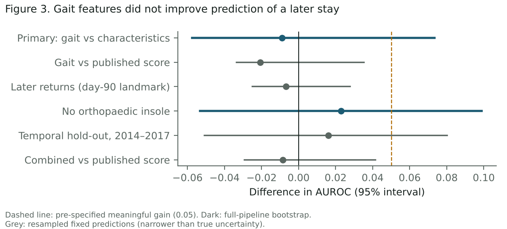
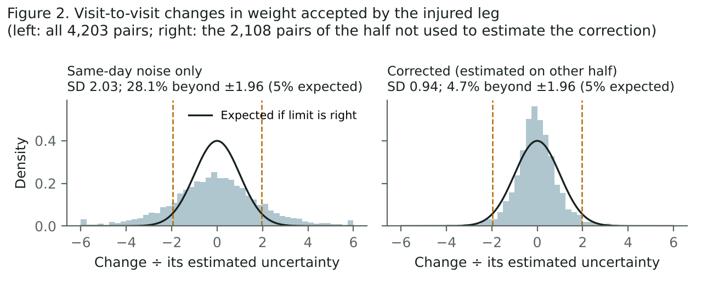
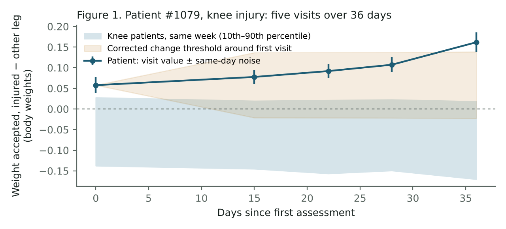
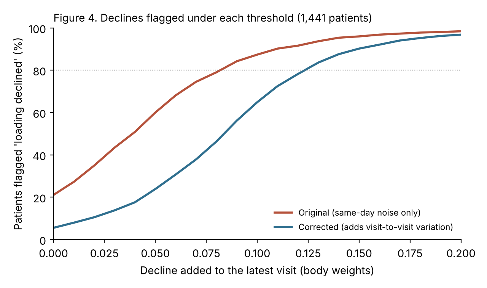

# Summary

Gait laboratories record detailed walking forces for many patients early in rehabilitation. This project asked two questions of those recordings.

**1. Do first-week force measurements predict a later rehabilitation stay?**

They did not, in a study of 1,667 patients whose analysis plan was frozen and hashed in advance from GaitRec, an open dataset from a rehabilitation centre of the Austrian Workers' Compensation Board (AUVA). Eighty-four patients (5.0%) had a later-stay gait assessment within a year.

- Cross-validated AUROC was 0.50 for age, sex, body mass and injury type, and 0.49 with three injured-leg force features added.
- The paired difference was −0.009 (95% interval −0.057 to 0.073).
- Every secondary and exploratory analysis was also null.
- A planted signal was recovered (AUROC 0.82 against a true 0.84), so the null reflects the data, not the pipeline.

**2. Can changes in a patient's measurements between visits be read reliably?**

Not with the noise estimate that is easiest to compute.

- Changes between consecutive visits were about twice as variable as same-day trial-to-trial noise predicts. 28% of changes crossed a limit that should be crossed 5% of the time.
- Adding the extra visit-to-visit variation, estimated on half the patients, gave a limit that behaved as intended on the other half: 4.7% crossed.
- With the corrected limit, the "lower than first visit" review prompt fell from 21.1% to 5.6% of patients. None of the remaining declines repeated at the next visit.
- One shared threshold worked across knee, ankle, hip and heel patients: 4.4% to 5.3% of changes in weight accepted crossed it in each group (5% intended).
- The correction has a cost. When a decline of known size was added to real patients' latest visits, the corrected threshold flagged 24% of 0.05 body-weight declines (the original flagged 60%). It needed a decline of about 0.12 body weights to flag 80%.

The second result is the more useful one. Any tool that tracks an individual patient's gait across visits needs a between-visit reliability estimate, not only a same-day one.

> **What this work shows**
>
> - Same-day trial-to-trial noise understates how much these force measurements move between visits, by about half.
> - A threshold that adds visit-to-visit variation gives the intended 5% crossing rate in patients it was not fitted to, in each of four lower-limb injury groups. Separate code, written from the protocol text, reproduces this.
> - First-week gait did not predict a later recorded rehabilitation stay in this cohort.
>
> **What it does not show**
>
> - That a threshold crossing means a clinically important change. The corrected threshold is *statistically* calibrated: it controls how often ordinary variation crosses it. It has not been tested against any clinical judgement or outcome.
> - That the corrected threshold is safe to rely on. It misses most declines smaller than about 0.08 body weights. Whether such declines matter clinically is unknown.
> - How much of the visit-to-visit variation is measurement error and how much is real change. That needs a test–retest study (`docs/test_retest_protocol.md`).
> - Anything about spine, upper-limb or other injuries, or about patients outside one Austrian centre in 2007–2018.
> - That clinicians can use the prototype. It has not been tested with users, and no one outside the project has checked the analysis.

# 1. Background

Patients who complete inpatient rehabilitation for a lower-limb injury sometimes return for another stay. In workers' compensation, such returns lengthen recovery and add coordination work for case managers and treating teams.

Instrumented gait analysis is usually done in the first week. If it carried early information about later care needs, it could justify earlier clinical review. If it is used to follow a patient over time, its changes need to be read against how much measurements normally move between visits.

Published work on GaitRec has classified impairment type and tracked recovery. Chakraborty et al. (2022) showed that distance from healthy gait, measured with an autoencoder, shrinks during rehabilitation. The literature search for this project found no study relating instrumented gait to a later rehabilitation stay.

# 2. Methods

The prediction study follows TRIPOD+AI. Its analysis plan (`docs/preregistration.md`) was written, frozen and hashed before any predictor was related to the outcome.

This is a **frozen internal protocol, not an independently timestamped pre-registration**. The freeze time was recorded by the author's own process, and the plan was not posted to a public registry before the analysis. The hash shows only that the file has not changed since it was frozen.

The audit and every deviation or post-hoc addition are listed in `docs/deviations.md`.

## 2.1 Data and cohort

GaitRec (Horsak et al., 2020) holds 75,732 walking trials from 2,084 patients and 211 healthy controls, recorded 2007–2018. All source files matched figshare's published MD5 checksums.

Raw forces are in newtons at 250 Hz. This was confirmed from the data: the median stance phase is 185 samples (0.74 s), and the median peak vertical force is 1.08 times body weight.

| Step | Patients |
|---|---|
| Patients in GaitRec | 2,084 |
| At least one session in the first recorded stay | 2,076 |
| One affected leg at the first assessment | 1,975 |
| Normal shoes at the first assessment | 1,759 |
| First assessment at least 365 days before the last patient session (10 April 2018) | **1,667** |
| Later-stay gait assessment within 365 days | **84 (5.0%)** |

The cohort was aged 9–80 (median 43). It was 78% male, and 35 patients were under 18; AUVA insures pupils and students as well as employees. Every cohort patient had at least three valid trials per leg at the first assessment.

## 2.2 Outcome

The outcome was the first gait assessment recorded under a later stay, within 365 days of the first assessment.

GaitRec records gait sessions, not admissions. Returns without a gait assessment, or to other facilities, are invisible, and no reason for any return is recorded.

## 2.3 Predictors and models

All predictors come from the first assessment:

- **Patient characteristics:** age, sex, body mass, injury group.
- **Gait features:** peak vertical loading, braking impulse and propulsive impulse. Each is computed from the raw force curves, divided by body weight, averaged over valid trials, and expressed as the affected leg minus the unaffected leg.
- **Reconstruction score (M1):** a reimplementation of Chakraborty et al. (2022). It uses a dense autoencoder instead of the original LSTM, trained only on healthy-control legs in each training fold.

| Model | Predictors | Parameters |
|---|---|---|
| M0 | Patient characteristics | 6 |
| M1 | M0 + reconstruction score | 7 |
| M2 | M0 + three gait features | 9 |
| M2+ | M0 + reconstruction score + gait features | 10 |

All models were L2-penalised logistic regressions. The penalty was chosen by inner 5-fold cross-validation, and the parameter budget followed the Riley et al. (2020) criteria.

## 2.4 Validation

The primary comparison, M2 against M0, used 5-fold patient-level cross-validation repeated 10 times. The interval came from 200 patient bootstrap resamples, each rerunning the whole pipeline, including penalty selection.

Pre-specified rule: a gain would be claimed only if the interval excluded zero.

Post-hoc additions:

- **Positive control:** an outcome driven by push-off asymmetry was planted into the real cohort at the same prevalence.
- **Reproduction check:** an independent rerun of the key results.

## 2.5 Monitoring and reliability

For each patient's first-stay visits, the monitoring component records:

- the affected-minus-unaffected difference in each feature;
- each visit's standard error from its repeated trials;
- the patient's percentile among other patients with the same injury in the same week.

Three pre-specified review prompts flag persistently low loading, loading lower than at the first visit, and loading above the 90th percentile.

The **protocol change limit** was 1.96 × √(SE₁² + SE₂²). This uses same-day noise only.

**Reliability analysis (post hoc).** For consecutive visits of the same patient:

- var(change) = (SE₁² + SE₂²) + τ²;
- τ is the extra visit-to-visit variation, estimated as √(var(change) − mean(SE₁² + SE₂²)).

The **corrected limit** is 1.96 × √(SE₁² + SE₂² + τ²).

To avoid estimating and testing on the same patients, τ was estimated on a random half of patients and evaluated on the other half, and vice versa. Each patient's prompts were computed with τ from the half they did not belong to.

# 3. Results

## 3.1 Prediction: primary analysis

| Model | AUROC | PR-AUC | Brier | PPV at 10% alert rate |
|---|---|---|---|---|
| M0, characteristics | 0.503 | 0.052 | 0.0479 | 4.1% |
| M1, + reconstruction score | 0.514 | 0.053 | 0.0479 | 4.4% |
| M2, + gait features | 0.494 | 0.051 | 0.0479 | 3.8% |
| M2+, + both | 0.506 | 0.052 | 0.0479 | 4.4% |

Means over 10 repeats of 5-fold cross-validation. Prevalence was 5.0%, so a model with no information scores an AUROC of 0.50, a PR-AUC of about 0.05, and a PPV of about 5%.

The paired AUROC difference, M2 minus M0, was **−0.009 (95% interval −0.057 to 0.073)**. The Brier score difference was effectively zero (−0.000004; interval −0.0001 to 0.0007).

Inner cross-validation chose the strongest penalty in the grid (C = 0.001). The predictions were therefore almost constant, and the calibration slopes (−0.21 to 0.14) cannot be interpreted.

Fitted without a penalty and scored on their own training data, M0 and M2 reached AUROCs of 0.58 and 0.61. This is the optimism that cross-validation removes.

Under the protocol's rule, no gain is claimed. The interval also includes a gain of 0.05, so a modest benefit cannot be ruled out.

## 3.2 Prediction: secondary and exploratory analyses

| Analysis | Patients (events) | AUROC difference (95% interval) |
|---|---|---|
| S1: M2 vs M1, head to head | 1,667 (84) | −0.021 (−0.034 to 0.035)\* |
| S2: later returns, day-90 landmark | 1,643 (60) | −0.007 (−0.025 to 0.028)\* |
| S4: no orthopaedic insole | 1,490 (74) | +0.023 (−0.053 to 0.099) |
| E1: temporal hold-out, 2014–2017 patients | 492 test (28) | +0.016 (−0.051 to 0.080)\* |
| E2: M2+ vs M1 | 1,667 (84) | −0.008 (−0.029 to 0.042)\* |

\* These intervals resample fixed predictions, so they omit model-development variability and are too narrow.

**S3, injury groups (descriptive).** The table shows AUROCs for M0 and M2.

| Group | Patients (events) | M0 | M2 |
|---|---|---|---|
| Knee | 525 (32) | 0.52 | 0.53 |
| Ankle | 511 (27) | 0.42 | 0.47 |
| Hip | 370 (14) | 0.62 | 0.58 |
| Heel | 261 (11) | 0.33 | 0.30 |

All group intervals span zero. Values below 0.5 in small groups reflect noise.

**E3, time to event** (1,759 patients, 134 later stays, censored at 10 April 2018): the C-index was 0.49 for M0 and 0.48 for M2.

**E4, missed events.** Each scenario assumes GaitRec captured a share *s* of true returns and adds 84(1/*s* − 1) events to patients recorded as event-free. Each scenario was run 200 times with refitting.

| Recording sensitivity (events added) | Added at random | Added toward poorer early gait |
|---|---|---|
| 0.9 (9) | −0.007 (−0.034 to 0.024) | +0.005 (−0.028 to 0.043) |
| 0.8 (21) | −0.006 (−0.040 to 0.028) | +0.020 (−0.020 to 0.066) |
| 0.6 (56) | −0.002 (−0.028 to 0.028) | +0.062 (0.012 to 0.117) |

Random under-recording did not change the null. A gain appeared only when 40% of returns were assumed missing and concentrated among patients with poorer gait. That scenario builds the gait link in by assumption.

**Positive control and reproduction.** The planted outcome produced 82 events, with a true AUROC of 0.836. The pipeline recovered 0.824 for M2 and 0.521 for M0.

An independent rerun reproduced the cohort, the M0 and M2 AUROCs and the primary difference to nine decimal places.

## 3.3 Monitoring: reliability of visit-to-visit change

The cohort had 5,870 first-stay visits (median 3 per patient). 1,441 patients had at least two visits (1,071 had three or more), giving 4,203 pairs of consecutive visits.

For weight accepted by the injured leg:

- **Same-day noise.** The typical standard error of one visit was 0.015 body weights. Combined over the two visits of a change, it was 0.024 (root mean square).
- **Average change.** The mean change between consecutive visits was −0.001 body weights, essentially none.
- **Spread of changes.** Changes divided by their same-day uncertainty had a standard deviation of 2.03 (1.0 expected). 28.1% fell outside ±1.96 (5% expected): 13.5% up and 14.6% down.
- **Extra visit-to-visit variation.** τ was 0.038 body weights (0.039 and 0.037 in the two halves). For braking and push-off, τ was 0.0028 and 0.0027 body-weight-seconds.

With the corrected limit, estimated on one half and tested on the other:

- standardised changes had a standard deviation of 0.94 and 1.01;
- 4.7% and 5.3% of changes fell outside ±1.96, close to the 5% expected.

The corrected limit is well calibrated for patients it was not estimated from.

## 3.4 Monitoring: review prompts under both limits

Patients with at least two visits: 1,441.

| Prompt | Protocol limit | Corrected limit |
|---|---|---|
| Lower loading than first visit | 304 (21.1%) | 80 (5.6%) |
| Persistent low loading | 54 (3.7%) | 80 (5.6%) |
| Loading above typical range | 100 (6.9%) | 100 (6.9%) |
| Any prompt | 457 (31.7%) | 260 (18.0%) |

**How the two limits relate.** The corrected "lower than first visit" prompts are a subset of the original ones. "Persistent low loading" gains 26 patients: when fewer changes count as real, more low-loading patients count as unchanged. The "above typical range" prompt does not use the change limit.

**Repetition.** With the protocol limit, 612 declines between consecutive visits crossed the limit, and 7% of these were followed by another decline at the next visit. With the corrected limit, 105 declines crossed it, and none was followed by another.

**Threshold sensitivity.** With the corrected limit, the "lower than first visit" rate was 8.9% at z = 1.645, 5.6% at z = 1.96 and 2.7% at z = 2.576.

Figure 1 shows patient 1079. The rise in loading across five visits exceeds the corrected threshold, and the patient sits above the typical range for knee patients. The page reports this as a measurement to review, not as a sign of better or worse recovery.

## 3.5 Monitoring: does one threshold fit all four injury groups?

All 4,203 visit pairs were split by injury group: knee 1,275 pairs, ankle 1,408, hip 788 and heel 732. Two questions were asked.

1. Does the extra visit-to-visit variation differ between groups?
2. Does a single pooled corrected threshold hold its 5% rate within each group?

As before, each threshold was estimated on the other half of patients. Intervals come from 500 bootstrap resamples of patients. Group differences were tested by permuting injury labels between patients (1,000 permutations).

| Injury group | τ, weight accepted (95% CI), body weights | Beyond pooled threshold | Beyond group's own threshold |
|---|---|---|---|
| Knee | 0.037 (0.033 to 0.040) | 5.2% | 5.5% |
| Ankle | 0.039 (0.035 to 0.044) | 5.3% | 5.3% |
| Hip | 0.037 (0.033 to 0.041) | 4.4% | 5.2% |
| Heel | 0.039 (0.033 to 0.043) | 5.1% | 5.2% |

**Weight accepted.** The groups did not differ (permutation p = 0.82). The pooled threshold stayed between 4.4% and 5.3% in every group.

**Braking.** There was no evidence of a difference (p = 0.27). The pooled threshold ranged from 4.6% to 6.2%, and group-specific thresholds were no better (5.3% to 6.2%).

**Push-off.** There was weak evidence of a difference (p = 0.043, not corrected for testing three measures). Hip patients had the lowest τ: 0.0020 body-weight-seconds, against 0.0027 to 0.0029 for the other groups. As a result, the pooled threshold was slightly strict for hip (4.2%) and slightly loose for knee (6.5%).

**Conclusion.** A single threshold is adequate for knee, ankle, hip and heel patients in this data. A hip-specific push-off threshold may be worth testing in new data, but the current evidence does not justify one.

## 3.6 Monitoring: which real declines does the corrected threshold miss? (post hoc)

A lower crossing rate is only half the picture. A wider limit also catches fewer real declines. To measure this, a decline of known size, δ, was subtracted from the latest visit's loading difference for each of the 1,441 patients, and the "lower than first visit" prompt was re-evaluated. τ was cross-fitted as in Section 3.3.

| Decline added (body weights) | Flagged, original limit | Flagged, corrected limit |
|---|---|---|
| 0 (none added) | 21.1% | 5.6% |
| 0.05 | 60.0% | 23.9% |
| 0.10 | 87.4% | 64.9% |
| 0.15 | 96.0% | 90.2% |

The median limit was 0.041 body weights for the original and 0.085 for the corrected. The decline needed to flag half of patients was 0.04 and 0.084 body weights; to flag 80%, it was 0.082 and 0.123. At δ = 0.10, the corrected threshold flagged 61% to 68% of patients in each injury group.

For scale, the injured-minus-uninjured loading difference at the first visit varied between patients with a standard deviation of 0.070 body weights. A decline of 0.05 body weights is therefore about 0.7 between-patient standard deviations. The corrected threshold misses about three-quarters of declines of that size.

**Interpretation.** The two thresholds trade false prompts against missed declines. The original threshold flags one patient in five with no added decline. The corrected threshold flags one in eighteen but misses most declines below about 0.08 body weights. This analysis cannot say which threshold is better clinically, because no one knows yet how large a decline in loading asymmetry matters for a patient. That question needs clinician input and an outcome, not more statistics.

The injected declines sit on top of each patient's real trajectory, which already contains real change. Detection is therefore of a decline in addition to what actually happened, not of a decline from a stable baseline.

## 3.7 Independent re-implementation (post hoc)

A second script (`verification/independent_reliability.py`) imports nothing from the analysis package. It was written from the protocol text and rebuilds the cohort, visit-level differences and standard errors, τ, calibration and alert rates from the metadata and trial-level files.

It reproduced exactly the patient, visit and pair counts, the mean visit standard error, τ for all three features, the 28.1% crossing rate, the standardised-change SD of 2.03, and the group τ values. The "lower than first visit" rate matched at 5.6%.

With a different patient split (odd and even IDs instead of random halves), the two held-out halves gave 6.7% and 3.9%, and pooled 5.3%. Calibration therefore holds on average, but a single half-sample estimate varies by about ±1.5 percentage points depending on the split.

The same author wrote both implementations, so this guards against coding errors, not against a shared misreading of the method. `docs/verification_guide.md` sets out a check for an outside reviewer.

# 4. Discussion

## 4.1 Prediction

In this cohort, the first gait assessment carried no detectable information about a later gait-recorded rehabilitation stay. Neither did age, sex, body mass or injury type.

The positive control shows the method could have found a moderate effect. The interval still allows a gain of up to about 0.07, so the conclusion is that no useful prediction was found, not that gait is irrelevant.

Plausible explanations:

- the outcome mixes planned and unplanned returns;
- some returns are unrecorded, though random under-recording would not hide a signal;
- the first visit is too early, or lacks the right measures, such as walking speed, pain and function.

## 4.2 Monitoring

The reliability result applies beyond this dataset. Repeated trials within one visit are a convenient way to estimate measurement error. On real data, though, they understated how much measurements move between visits:

- τ = 0.038 body weights is about 2.5 times the 0.015 same-day standard error of a single visit;
- the spread of visit-to-visit changes was about twice what same-day noise predicts.

Used as pre-specified, the same-day limit generated a "lower than first visit" prompt for one patient in five. Those prompts rarely repeated, which points to day-to-day variation rather than real decline.

A limit that adds the visit-to-visit component behaved as intended in patients it was not fitted to, and cut that prompt to about one patient in eighteen. The same limit held in each of the four injury groups. A monitoring tool for these lower-limb injuries can therefore share one threshold rather than needing one per diagnosis.

**Statistical calibration is not clinical detection.** "Calibrated" here means only that ordinary variation crosses the limit about 5% of the time. It does not mean the limit separates patients who are getting worse from those who are not. Section 3.6 shows the price: a smaller decline of 0.05 body weights is flagged only one time in four. If clinicians judge declines of that size important, the corrected threshold is too blunt, and the answer is better measurement (more trials per visit, controlled walking speed), not a different statistical rule.

**Scope.** These results cover four lower-limb injury groups measured with force plates. They say nothing about spine, shoulder, hand or other workers' compensation injuries. A patient with a shoulder injury may walk normally, so those injuries would need their own measurements, such as range of motion, grip strength or validated function scores. The parts of this software that do not depend on the measurement could be reused for them: tracking visits over time, estimating visit-to-visit reliability, wording review prompts safely, and testing all of it automatically. Each new injury type would still need its own reliability study.

Some of the visit-to-visit variation may be real change, such as patients improving and fluctuating. Separating real change from measurement variation needs test–retest sessions taken a few days apart in stable patients. That data is not in GaitRec and would be the first requirement for a clinical version.

## 4.3 Limitations

- **Outcome.** Recorded rehabilitation use, with unknown reasons and incomplete capture.
- **Setting.** One Austrian inpatient centre, 2007–2018. The cohort includes 35 patients under 18, and not every patient necessarily had a work injury.
- **Walking speed.** Not recorded.
- **Exclusions.** Restricting to normal shoes and one affected leg excluded 317 patients.
- **M1.** Reimplemented with a dense autoencoder rather than the original LSTM.
- **Reliability estimate.** τ mixes measurement variation with any real short-term change, and is estimated from routine visits, not a test–retest design. A protocol for that study is in `docs/test_retest_protocol.md`.
- **Detection.** The corrected threshold misses most declines below about 0.08 body weights (Section 3.6). Its clinical adequacy is unknown.
- **Verification.** Both implementations were written by the author. No outside statistician has checked the work yet.
- **Usability.** Not tested with clinicians or case managers yet. A protocol is in `docs/usability_protocol.md`, and a feedback form is in `docs/clinician_feedback_form.md`.

## 4.4 Analysis protocol and deviations

The plan file's hash still matches. Because the freeze time was recorded by the author and no registry timestamped the plan beforehand, readers have to take the order of work on trust. If the plan is posted to OSF, it should be labelled as a frozen internal protocol posted after the analysis.

Protocol analyses, deviations (the E3 penalty, uninterpretable calibration slopes, the M1 architecture) and post-hoc additions (positive control, reliability analysis, corrected limit, alert analysis) are listed in `docs/deviations.md`.

# 5. Software and prototype

The analysis is a Python package with 37 automated tests, including:

- regression tests that reproduce the audited cohort from the real metadata;
- analytic checks of the force calculations;
- a test that fails if the affected-side coding were reversed;
- guards against mixing patients, using future information and train/test overlap;
- a check that the autoencoder never sees held-out healthy controls;
- a check that the reliability estimator recovers a planted between-visit variation.

A hazard log links each risk to its mitigation and test. A script checks every number quoted in this report against the result files. A separate re-implementation (Section 3.7) and SHA-256 checksums of the derived data (`docs/data_checksums.txt`) support outside checking.

The interactive prototype (`prototype/gait_review.html`) covers all 1,667 patients. For each, it shows:

- visit-by-visit measurements with same-day noise bars and injury-group bands;
- a one-sentence summary of what changed;
- the review prompts under either limit;
- a list of what the treating clinician would need to check before acting.

Every page carries a fixed notice limiting it to research use. It makes no deterioration, recovery-failure, causation, compensability, impairment or work-capacity statements.

# References

1. Chakraborty J, Upadhyay S, Nandy A. Musculoskeletal injury recovery assessment using gait analysis with ground reaction force sensor. *Medical Engineering & Physics*. 2022;103:103788.
2. Collins GS, Moons KGM, Dhiman P, et al. TRIPOD+AI statement: updated guidance for reporting clinical prediction models that use regression or machine learning methods. *BMJ*. 2024;385:e078378.
3. Horsak B, Slijepcevic D, Raberger AM, Schwab C, Worisch M, Zeppelzauer M. GaitRec, a large-scale ground reaction force dataset of healthy and impaired gait. *Scientific Data*. 2020;7:143.
4. Riley RD, Ensor J, Snell KIE, et al. Calculating the sample size required for developing a clinical prediction model. *BMJ*. 2020;368:m441.
