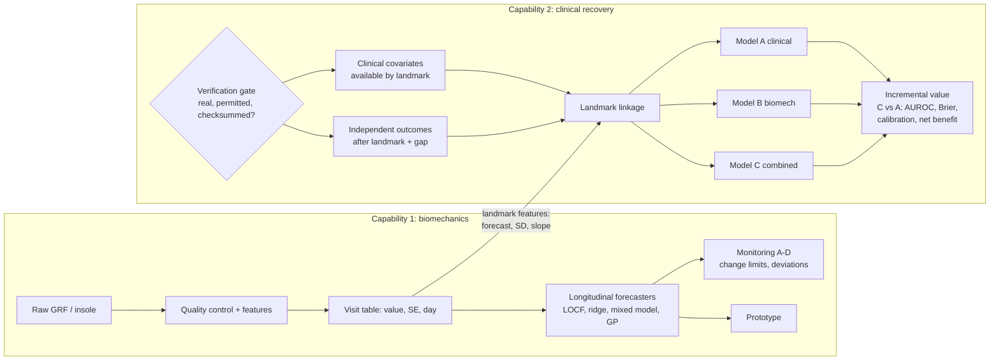

# GaitSense v3.0 — platform architecture

GaitSense is one research platform with two complementary model families. Both are maintained; neither replaces
the other.

| | Capability 1: biomechanical forecasting and monitoring | Capability 2: clinical recovery prediction |
|---|---|---|
| Question | What will this patient's next force measurement be, how uncertain is that, and is an observed change unusual? | Do uncertainty-aware biomechanical forecasts add predictive value for independently measured recovery outcomes beyond clinical data alone? |
| Status | Validated on GaitRec (v2.0, frozen results); improved in v3.0 where evidence supports it | Infrastructure built and tested on synthetic controls; **no clinical results**; waits for a verified linked dataset |
| Data | Repeated force-plate (or insole) measurements | The same patients' biomechanics plus clinical covariates and independently measured outcomes |
| Code | `src/gaitsense_ai/` (v2.0) and `src/gaitsense_platform/capability1.py` | `src/gaitsense_platform/{contracts,gate,linkage,clinical,pipeline}.py` |
| Runs alone? | Yes | Model A (clinical only) runs without biomechanics; Models B and C need Capability 1 features |

## How the two connect scientifically

At a landmark day L (for example six weeks after injury), Capability 1 summarises each patient's biomechanics using
only visits on or before L: last value, observed slope, smoothed current level and its uncertainty, and a forecast
for a later horizon with its predictive SD. Capability 2 then compares Model A (clinical covariates available by L),
Model B (biomechanical features) and Model C (both) for an outcome assessed independently after L. The primary
estimand is the difference between C and A. A positive difference would mean the forecasts carry information about
recovery that clinical data do not; it would not mean that biomechanical improvement is recovery.

## Safeguards

- **Verification gate** (`gate.py`): a real analysis requires a complete provenance manifest (source, licence or
  data-use agreement, ethics reference, who obtained and verified the data) and matching SHA-256 checksums for every
  data file. Synthetic data are refused unless a test explicitly allows them, and their outputs carry a banner.
- **Outcome independence** (`contracts.py`): outcome rows must be flagged as measured independently of the
  biomechanics; gait-derived labels are rejected.
- **Landmark linkage** (`linkage.py`): predictors use nothing after L; outcomes must fall after L plus a gap; tests
  corrupt post-landmark data and confirm the features do not change.
- **Separate validation**: Capability 2 has its own protocol (`docs/v3_capability2_protocol.md`), frozen and hashed
  only when a dataset has been verified and before outcomes are examined.
- **Frozen v2.0 results**: `results/ai/` is untouched; v3.0 analyses write to `results/v3/`.

## Intended application: workers' compensation rehabilitation

Possible future users, none of whom is served by validated evidence yet: injured workers (clearer information about
measured change), treating clinicians and physical therapists (when to reassess), nurse case managers (prioritising
discussions with treating providers), and adjusters (clinician-reviewed context). The platform supports clinical
review. It does not make benefit, impairment, MMI, return-to-work or claim decisions, and its outputs should not be
used to deny or end care.

## Roadmap

1. Capability 1: external check on another force dataset; heavier-tailed predictive distributions; prospective
   test–retest data to separate measurement error from change.
2. Capability 2: obtain a verified linked dataset (`docs/v3_dataset_assessment.md`); freeze the protocol; run
   Models A/B/C once; report whatever the comparison shows.
3. Workers' compensation study: prospective collection with validated function and pain scales and return-to-work
   dates, under ethics approval.
